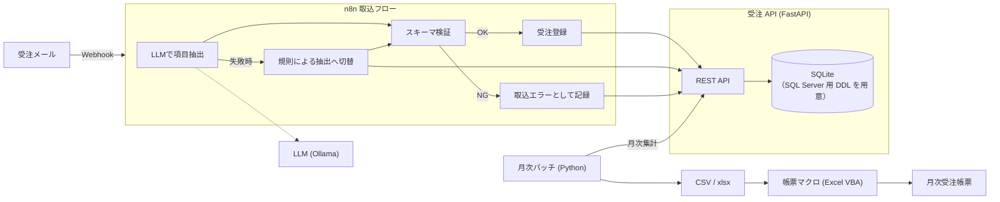
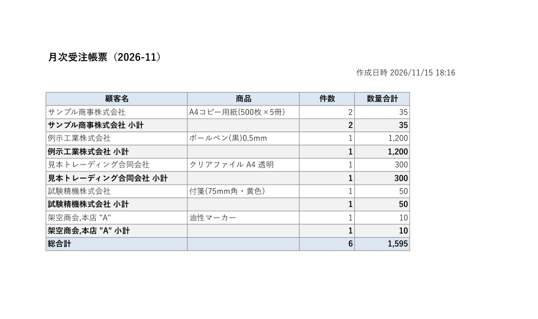

# 受注メール取り込み・月次帳票システム

[](https://github.com/takato-y/order-intake-system/actions/workflows/test.yml)

**受注メールを台帳へ書き写す作業と、月末の集計・帳票づくりをなくす業務システムです。**

取引先からの注文メールを受け取ると、顧客名・商品・数量・希望納期を自動で読み取って受注データとして登録します（お使いのメールとの接続方法は「動かし方」を参照）。月初には前月分の顧客別・商品別の集計が自動で出力され、Excel のマクロを 1 回実行するだけで月次帳票ができあがります。複数の技術を組み合わせ、1 つの業務の流れとして動くように設計しています（使っている技術は下の表のとおりです）。

本リポジトリはポートフォリオ（閲覧用）です。無断での再利用・再配布はご遠慮ください。

## 概要

想定する業務は、事務用品を扱う架空の卸売会社の受注事務です（会社名・取引先名・メールはすべて架空です）。

| これまで | このシステムを入れた後 |
|---|---|
| 担当者がメール本文を読み、受注台帳へ手で転記する | メールが届くと、顧客名・商品・数量・希望納期を自動で取り出して登録する |
| 再送されたメールを別の注文として登録してしまう | 同じメールは何度届いても 1 件しか登録されない |
| 書き方が決まっていない注文を読み落とす | 生成 AI が文章形式の注文も読み取る。読み取れないものは理由つきで「取込エラー」に残り、黙って抜け落ちない |
| 月末に関数とピボットで集計し、帳票を作る | 毎月 1 日に前月分の集計ファイルが自動で出力され、マクロ 1 回で帳票ができる |

## 全体構成図



処理の順序（シーケンス図）・各構成要素の役割は [docs/02_方式設計.md](docs/02_方式設計.md) と [docs/03_基本設計.md](docs/03_基本設計.md) にまとめています。

## 使っている技術と役割

| 技術 | 役割 | 主なファイル |
|---|---|---|
| n8n | メールの受け取り、LLM の呼び出し、検証、API への登録、エラー時の分岐 | `n8n/order-intake.json` |
| LLM（Ollama / qwen2.5） | メール本文から受注項目を JSON で取り出す | `app/extractor.py`、n8n の「LLMで項目抽出」 |
| Python / FastAPI | 入力検証・重複判定・登録・一覧・月次集計、LLM が使えないときの規則による抽出 | `app/` |
| JSON スキーマ | 受注データの規則を 1 か所で定義し、API と n8n で共有 | `app/order_schema.json` |
| SQLite / SQL Server | 受注・顧客・商品・取込エラーの保存。SQL Server 用 DDL を用意（SQL Server での実行は未確認） | `sql/` |
| Python（バッチ）/ PowerShell | 月次集計を CSV・xlsx に出力。タスクスケジューラから起動するためのラッパーを用意（Windows での実行は未確認） | `batch/` |
| Excel VBA | CSV を取り込み、小計・総合計つきの帳票を作成 | `src/MonthlyReport.bas` |
| pytest / GitHub Actions | 抽出・検証・重複・集計・n8n フローの自動テスト（pytest はローカルと GitHub Actions の両方で実行し、合格） | `tests/`、`.github/workflows/test.yml` |
| Docker Compose | 確認用に API（必要なら n8n も）を起動する定義（compose での起動は未確認。同じ Dockerfile の docker build・run で確認済み） | `docker-compose.yml` |

## 動かし方

LLM や外部サービスがなくても、規則による抽出で全体が動きます。

API と Webhook（メールの内容を受け取る n8n の受付口）は認証なし・ローカル（社内）専用の構成です。外部に公開する場合は認証が必要です（[docs/02_方式設計.md](docs/02_方式設計.md) の 6 章を参照）。

### Docker を使う場合

`docker compose up` での起動は未確認です（同じ Dockerfile での `docker build`・`docker run` は確認済み）。ポートは 127.0.0.1 にだけ公開します。

```bash
docker compose up -d --build          # API だけを起動（http://localhost:8000/docs で API の画面）
docker compose --profile n8n up -d    # n8n も起動する場合（http://localhost:5678）
```

### Docker を使わない場合（Python 3.12）

```bash
python -m venv .venv
source .venv/bin/activate             # Windows は .venv\Scripts\activate
pip install -r requirements-dev.txt
uvicorn app.main:app --port 8000      # 別のターミナルで以下を実行
```

### サンプルのメールを流して月次帳票を作る

```bash
python scripts/send_samples.py                       # 架空の受注メール 7 通を API に送る
python -m batch.monthly_report --month 2026-11       # output/ に CSV と xlsx を出力
python -m pytest -v                                  # 自動テスト
```

- n8n を使う場合は `n8n/order-intake.json` を取り込み、「設定」ノードの接続先（受注 API と Ollama の URL・モデル名）を使う環境に合わせてからフローを有効化し、`python scripts/send_samples.py --url http://localhost:5678/webhook/order-intake` で送ります。Gmail から直接取り込む場合の差し替え方は [docs/05_インターフェース設計.md](docs/05_インターフェース設計.md) の 3.2 にあります
- LLM を API 側でも使う場合は、環境変数 `EXTRACTOR_MODE=auto`、`OLLAMA_URL`、`OLLAMA_MODEL` を指定します
- 帳票は Excel で VBA エディタを開き、`src/MonthlyReport.bas` を取り込んでマクロ `CreateMonthlyReport` を実行し、出力された CSV を選びます。ファイルは GitHub で読めるよう UTF-8 で保存しているため、日本語版 Excel に取り込む前に Shift_JIS へ変換してください（例：`iconv -f UTF-8 -t CP932 src/MonthlyReport.bas > MonthlyReport_sjis.bas`）
- 毎月の定期実行の登録例は [docs/08_運用設計.md](docs/08_運用設計.md) にあります

## 実行例

架空の受注メール 7 通を、ローカルの n8n と LLM（qwen2.5:7b）の経路で流した結果です。

```
201  01_定型_項目名あり            登録: サンプル商事株式会社 / A4コピー用紙(500枚×5冊) / 20 / 2026-11-10 [llm]
201  02_隅付き括弧の項目名           登録: 例示工業株式会社 / ボールペン(黒)0.5mm / 1200 / 2026-11-20 [llm]
201  03_署名から顧客名             登録: 見本トレーディング合同会社 / クリアファイル A4 透明 / 300 / 2026-11-25 [llm]
200  04_再送メール_重複            重複（既存を返却）: サンプル商事株式会社 / A4コピー用紙(500枚×5冊) / 20 / 2026-11-10 [llm]
201  05_同一顧客の別注文            登録: サンプル商事株式会社 / A4コピー用紙(500枚×5冊) / 15 / 2026-11-27 [llm]
201  06_文章形式_項目名なし          登録: 試験精機株式会社 / 付箋(75mm角・黄色) / 50 / 2026-11-28 [llm]
422  07_数量なし_不備             不合格: quantity=必須項目がありません
```

再送メール（04）は重複として扱われ、数量が書かれていないメール（07）は登録されずに取込エラーとして記録されます。続けて月次バッチを実行すると、次の CSV ができます。

```
集計月,顧客名,商品,件数,数量合計
2026-11,サンプル商事株式会社,A4コピー用紙(500枚×5冊),2,35
2026-11,例示工業株式会社,ボールペン(黒)0.5mm,1,1200
2026-11,見本トレーディング合同会社,クリアファイル A4 透明,1,300
2026-11,試験精機株式会社,付箋(75mm角・黄色),1,50
```

この CSV を帳票マクロで取り込み、PDF に出力した帳票の画像です（Excel で実際に実行した結果）。最終行の「架空商会,本店 "A"」は、カンマと引用符を含む顧客名を正しく取り込めるか確認するために、検証用として CSV に 1 行足したものです。



LLM を止めた場合は、文章形式のメール（06）だけが取込エラーになり、ほかのメールは規則による抽出で登録されます（[docs/07_テスト仕様書.md](docs/07_テスト仕様書.md) の TC-031）。

## 設計で工夫した点

### 重複を防ぐ

メールの Message-ID（メールごとに付く識別子）に、データベースの一意制約（同じ値を 2 件登録できない制約）を付け、登録時の制約違反を「登録済み」と判断しています。「登録済みか調べてから登録する」方式は、同じメールが同時に届くと両方が通ってしまうためです。同じメールを 8 件同時に登録しても 1 件しか登録されないことを、テストで確認しています。重複時は既存の受注を正常応答で返すので、n8n 側は通信エラー時に安心して再試行できます（[ADR-0003](docs/adr/0003-message-idによる冪等性.md)）。

### 二重の検証

受注データの規則は JSON スキーマ 1 つにまとめ、n8n の検証ノードと API の両方で同じ規則を使っています。n8n には生成スクリプトでスキーマを埋め込み、「埋め込んだスキーマが API と同じか」「JavaScript と Python の判定が同じか」を自動テストで確認しています。API ではさらに「実在する日付か」「納期が受信日より前でないか」を確認します。

### LLM が使えないときの代替

LLM の停止・タイムアウト・出力の崩れが起きても、取り込みは止まりません。n8n では API の規則による抽出に切り替え、API 単体でも `EXTRACTOR_MODE=auto` で同じ切り替えをします。規則で読み取れない項目があれば検証で不合格になり、理由つきで記録されるため、誤った受注が黙って登録されることはありません（[ADR-0002](docs/adr/0002-llm失敗時のルールベース代替.md)）。

### SQL Server への移行のしやすさ

開始時は導入の手間がない SQLite を使い、SQL Server 用 DDL を用意しています（SQL Server での実行は未確認）。SQL は標準の範囲で書き、月の絞り込みもデータベース製品ごとに異なる独自の関数を使わず「月初以上・翌月初未満」の範囲条件で書いているため、移行時に変えるのはデータベースへの接続部分だけで済む設計です。型の対応表と移行手順は [docs/04_テーブル定義書.md](docs/04_テーブル定義書.md) にあります（[ADR-0001](docs/adr/0001-sqlite採用とsqlserver移行方針.md)）。

### 個人に関わる情報を残さない

メール本文はデータベースに保存せず、受注に必要な項目だけを残します。取込エラーも理由だけを記録します。n8n のフローは成功した実行の履歴を保存しない設定にしています（失敗時の履歴には本文が残るため、保存期間は n8n 側で設定します）。

### 帳票を開いたときに数式として動かない

顧客名・商品名はメールから取り出した外部の文字列です。「=」「+」「-」「@」で始まる値は、CSV では先頭に「'」を付け、xlsx では文字列型に固定し、帳票マクロでも文字列として書き込みます。全角の「＝」も登録時に半角へそろえたうえで同じ扱いになります。

## 設計書

| 文書 | 内容 |
|---|---|
| [01_要件定義](docs/01_要件定義.md) | 業務の背景・課題、機能要件 REQ-001〜008、非機能要件 REQ-009〜013、対象外 |
| [02_方式設計](docs/02_方式設計.md) | システム構成図、構成要素、技術選定の理由、環境 |
| [03_基本設計](docs/03_基本設計.md) | 機能一覧 FN-001〜009、要件と機能の対応、業務フロー、帳票レイアウト |
| [04_テーブル定義書](docs/04_テーブル定義書.md) | テーブル定義（DDL から生成）、ER 図、SQLite と SQL Server の対応 |
| [05_インターフェース設計](docs/05_インターフェース設計.md) | API 仕様、エラーコード、n8n との連携、CSV レイアウト |
| [06_詳細設計](docs/06_詳細設計.md) | 抽出・重複判定・集計バッチの処理フロー、例外処理、ログ方針 |
| [07_テスト仕様書](docs/07_テスト仕様書.md) | TC-001〜044 と実施結果（未実施の項目も明記） |
| [08_運用設計](docs/08_運用設計.md) | ジョブ一覧、障害対応表、バックアップ、定期点検、資格情報の更新、連絡体制 |
| [09_障害対応手順書](docs/09_障害対応手順書.md) | 障害時の流れ、切り分けの順番、エラーID（ERR-001〜008）ごとの対応手順、記録と報告 |
| [flows/FLW-001](docs/flows/FLW-001_受注メール取込.md) | n8n フローのノード一覧（エクスポートから生成） |
| [adr/](docs/adr/) | 主な設計判断の記録 |

要件からテストまでのつながり（抜粋）：

| 要件 | 機能 | テスト |
|---|---|---|
| REQ-003 重複登録しない | FN-003 受注登録 | TC-003（再送）、TC-004（8 並列の同時登録） |
| REQ-008 LLM なしでも継続 | FN-002 抽出、FN-001 取込フロー | TC-021・TC-022（自動テスト）、TC-031（n8n で LLM を止めて確認） |
| REQ-007 月次帳票 | FN-009 帳票マクロ | TC-035（Excel で実行） |

### 自動テストで確認している範囲

- GitHub Actions で検査している範囲：API・抽出・月次バッチ・n8n フロー JSON の構造（tests/test_n8n_workflow.py）・設計書の突き合わせを対象とする自動テスト（pytest）と、n8n フローを生成し直した結果がリポジトリの JSON と一致するかの確認
- 手元の環境でのみ確認した範囲：n8n と実際の LLM を使った取込（TC-030〜033）、LLM なしの API と月次バッチの通し確認（TC-034）、Excel の帳票マクロ（TC-035・TC-041）、Docker での起動（TC-036）、n8n の配備前検査（TC-039）、n8n の実行履歴の設定（TC-042）。SQL Server でのテーブル作成用 SQL（DDL）の実行と、PowerShell の起動用スクリプト（ラッパー）は未実施（TC-037・TC-038）

## ディレクトリ構成

```
order-intake-system/
├── app/                 受注 API（FastAPI）・抽出・検証・データアクセス
├── batch/               月次集計バッチ（Python）と PowerShell ラッパー
├── src/                 Excel VBA の帳票マクロ
├── n8n/                 n8n 取込フロー（エクスポートした JSON）
├── sql/                 DDL（SQLite / SQL Server）
├── samples/emails/      架空の受注メール
├── scripts/             サンプル送信スクリプト
├── tools/               n8n フローの生成スクリプト
├── tests/               自動テスト（pytest）
├── docs/                設計書・設計判断の記録・画像
├── Dockerfile
├── docker-compose.yml
└── .github/workflows/   自動テストの設定
```

## 動作環境

| 項目 | 確認した環境 |
|---|---|
| OS | Windows 11 + WSL2（Ubuntu 24.04） |
| Python | 3.12（ライブラリの版は `requirements.txt`） |
| n8n | 2.3.5（Docker） |
| LLM | Ollama 0.20.7、qwen2.5:7b |
| Excel | Windows 版 Excel（デスクトップアプリ） |
| Docker | Docker Desktop（Compose v5） |

確認していないこと：SQL Server での DDL の実行、PowerShell ラッパーの Windows での実行、`docker compose up` によるコンテナ起動（同じ Dockerfile での `docker build`・`docker run` と、`docker compose config` は確認済み）。GitHub Actions 上での自動テストは公開後に実行し、47 件合格・1 件スキップ（実際の LLM を使う 1 件は GitHub Actions では実行しない設定）を確認済み。障害対応手順書の検査（TC-044）を加えた後のローカルでの実行結果は 48 件合格・1 件スキップ。
