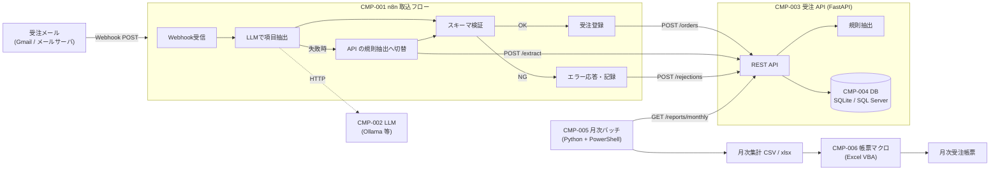

# 方式設計書

## 文書情報

| 項目 | 内容 |
|---|---|
| 文書名 | 方式設計書 |
| 文書ID | AD-001 |
| システム名 | 受注メール取り込み・月次帳票システム |
| 版 | 1.0 |
| 作成日 | 2026-11-15 |
| 状態 | 承認済 |

## 改版履歴

| 版 | 日付 | 変更内容 |
|---|---|---|
| 1.0 | 2026-11-15 | 新規作成 |

## 1. システム構成図

## 2. 構成要素と役割

| ID | 構成要素 | 役割 | 実装 |
|---|---|---|---|
| CMP-001 | 取込フロー | メールの受信、LLM による項目抽出、スキーマ検証、API への登録、エラー時の分岐 | n8n ワークフロー（`n8n/order-intake.json`） |
| CMP-002 | LLM | メール本文から受注項目を JSON で取り出す | Ollama（ローカル LLM）。API 互換の別サービスに置き換え可 |
| CMP-003 | 受注 API | 入力検証、重複判定、登録、一覧、月次集計、規則による抽出 | Python / FastAPI（`app/`） |
| CMP-004 | データベース | 受注・顧客・商品・取込エラーの保存 | SQLite（開始時）。SQL Server 用 DDL を用意 |
| CMP-005 | 月次バッチ | 月次集計の取得と CSV・xlsx 出力 | Python（`batch/monthly_report.py`）、PowerShell ラッパー |
| CMP-006 | 帳票マクロ | CSV を取り込み、帳票テンプレートに整形して出力 | Excel VBA（`src/MonthlyReport.bas`） |

## 3. 技術選定の理由

| 対象 | 採用 | 理由 | 主な代替案 |
|---|---|---|---|
| メール取込・連携 | n8n | メール・LLM・HTTP の連携を画面で組め、取込経路（Gmail / IMAP / Webhook）の差し替えがノード交換で済む | Power Automate、Make |
| 業務ロジック | Python / FastAPI | 検証・重複判定・集計をコードで書き、自動テストで品質を担保できる。入力スキーマから API 仕様を自動生成できる | Flask、n8n のコードノードのみで実装 |
| 抽出 | LLM ＋ 規則による抽出 | 書式の揺れには LLM が強い。LLM が使えないときは規則で継続する（ADR-0002） | LLM のみ、規則のみ |
| データベース | SQLite → SQL Server | 導入の手間がなく小規模に向く。標準 SQL の範囲で書き、移行を容易にする（ADR-0001） | 最初から SQL Server |
| 帳票 | Excel VBA | 利用部門が使い慣れた Excel 上で、既存の帳票テンプレートを活かせる | Python で xlsx を直接整形 |
| 実行環境 | Docker Compose ／ venv | 確認者が 1 コマンドで起動できる。Docker がない環境でも venv で動く | — |

## 4. 環境

| 環境 | 用途 | 構成 |
|---|---|---|
| 開発 | 実装・テスト | Windows + WSL2（Ubuntu）、Python 3.12、venv。n8n・Ollama はローカルで起動 |
| 確認用 | 第三者の動作確認 | `docker compose up` で API を起動（n8n は profile 指定で任意起動） |
| 本番（想定） | 社内運用 | 社内サーバ上の API ＋ n8n。DB は利用規模に応じて SQL Server へ移行 |

## 5. 非機能の方針

| 要件 | 方針 |
|---|---|
| REQ-009 | Message-ID に一意制約を付け、登録時の一意制約違反を「既に登録済み」として扱う（ADR-0003） |
| REQ-010 | n8n の LLM 呼び出しが失敗したら API の規則抽出に切り替える。API 登録は再試行を有効にする（冪等のため安全） |
| REQ-011 | 接続先・モデル名は環境変数か n8n の設定ノードで与え、リポジトリに秘匿値を置かない。本文は保存しない |
| REQ-012 | pytest で抽出・検証・重複・集計・API を自動テストする。GitHub Actions で push ごとに実行する |
| REQ-013 | 日付は ISO 8601 文字列、月の絞り込みは範囲条件で書き、方言関数（strftime 等）に依存しない。SQL Server 用 DDL を併記する |

## 6. 公開する場合の追加対策

本システムは社内ネットワークでの利用を前提とし、API に認証を設けていません。外部に公開する場合は、少なくとも次を追加します。

- API の前段にリバースプロキシを置き、API キーまたは OAuth による認証をかける
- n8n の Webhook にヘッダー認証を設定する
- 通信を HTTPS にする
