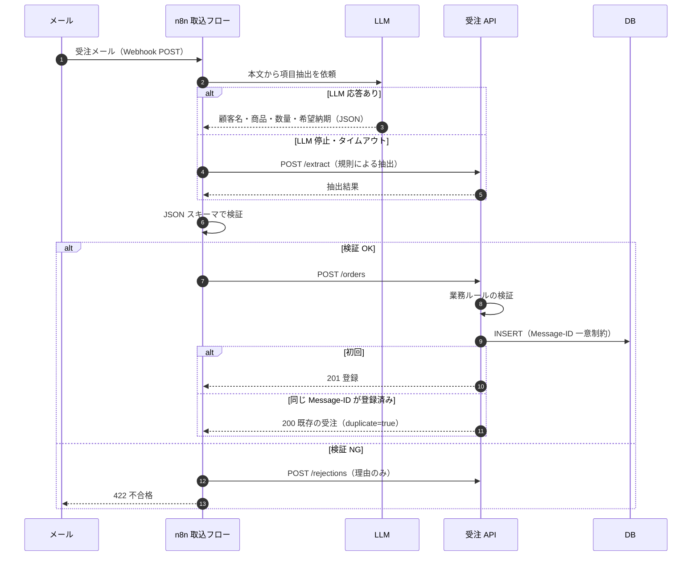
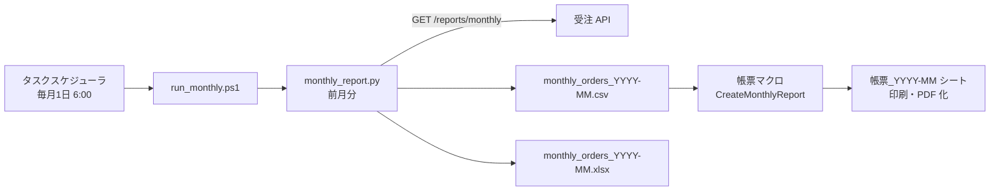
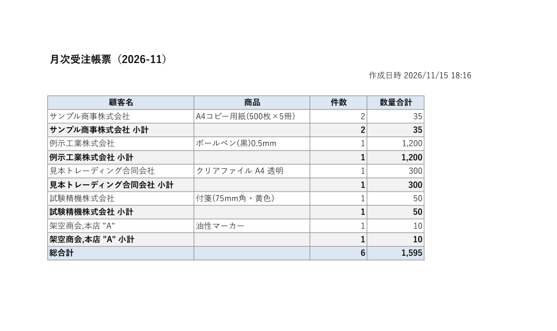

# 基本設計書

## 文書情報

| 項目 | 内容 |
|---|---|
| 文書名 | 基本設計書 |
| 文書ID | BD-001 |
| システム名 | 受注メール取り込み・月次帳票システム |
| 版 | 1.0 |
| 作成日 | 2026-11-15 |
| 状態 | 承認済 |

## 改版履歴

| 版 | 日付 | 変更内容 |
|---|---|---|
| 1.0 | 2026-11-15 | 新規作成 |

## 1. 機能一覧

機能の詳細は 06_詳細設計.md の各見出しに記載する。

| 機能ID | 機能名 | 実装 | 関連要件 |
|---|---|---|---|
| FN-001 | 受注メール取込フロー | n8n（FLW-001、`n8n/order-intake.json`） | REQ-001, REQ-002, REQ-008, REQ-010 |
| FN-002 | 受注項目の抽出（規則・LLM・自動切替） | `app/extractor.py` | REQ-001, REQ-008 |
| FN-003 | 受注登録（検証・重複判定） | `POST /orders`、`app/validation.py`、`app/db.py` | REQ-001, REQ-002, REQ-003, REQ-009, REQ-011 |
| FN-004 | メール取込 API | `POST /intake/email`、`POST /extract` | REQ-001, REQ-008, REQ-010 |
| FN-005 | 受注一覧 | `GET /orders` | REQ-004 |
| FN-006 | 月次集計 API | `GET /reports/monthly` | REQ-005, REQ-013 |
| FN-007 | 取込エラーの記録 | `POST /rejections`、`GET /rejections` | REQ-002, REQ-011 |
| FN-008 | 月次集計バッチ | `batch/monthly_report.py`、`batch/run_monthly.ps1` | REQ-006 |
| FN-009 | 月次帳票作成 | `src/MonthlyReport.bas`（Excel VBA） | REQ-007 |

## 2. 要件と機能の対応

| 要件ID | 実現する機能 | 確認するテスト（07_テスト仕様書.md） |
|---|---|---|
| REQ-001 | FN-001, FN-002, FN-003, FN-004 | TC-001, TC-015〜TC-017, TC-024, TC-030 |
| REQ-002 | FN-001, FN-003, FN-007 | TC-005, TC-006, TC-014, TC-032 |
| REQ-003 | FN-003 | TC-003, TC-024, TC-030 |
| REQ-004 | FN-005 | TC-011 |
| REQ-005 | FN-006 | TC-012, TC-013 |
| REQ-006 | FN-008 | TC-027〜TC-029, TC-034 |
| REQ-007 | FN-009 | TC-035 |
| REQ-008 | FN-001, FN-002, FN-004 | TC-021, TC-022, TC-031 |
| REQ-009 | FN-003 | TC-004 |
| REQ-010 | FN-001, FN-004 | TC-031, TC-033 |
| REQ-011 | FN-003, FN-007 | TC-005（本文を保存せず理由のみ記録） |
| REQ-012 | テスト全般 | TC-001〜TC-029（pytest）、`.github/workflows/test.yml` |
| REQ-013 | FN-006 | TC-012（範囲条件による月の絞り込み）、TC-038 |

## 3. 業務フロー

### 3.1 受注の取り込み（日次・随時）

### 3.2 月次の締め（毎月 1 日）

担当者の作業は、月初に帳票マクロを実行して CSV を選ぶことだけになる。

## 4. 帳票レイアウト

### 4.1 月次受注帳票（FN-009）

| 位置 | 内容 | 書式 |
|---|---|---|
| A1 | 「月次受注帳票（YYYY-MM）」 | 14pt 太字 |
| D2 | 作成日時（yyyy/mm/dd hh:nn） | — |
| A4:D4 | 見出し：顧客名・商品・件数・数量合計 | 太字・背景色・中央揃え。印刷時は各ページに繰り返す |
| 5 行目以降 | 明細（顧客名順・商品名順） | 件数・数量は 3 桁区切り |
| 顧客の切れ目 | 「〇〇 小計」行 | 太字・薄い灰色 |
| 最終行 | 「総合計」行 | 太字・薄い青 |
| 印刷 | A4 縦、横 1 ページに収める、フッターにページ番号 | — |

出力例（実際に Excel でマクロを実行し、PDF に出力した画面）：

※ 最終行の「架空商会,本店 "A"」は、カンマと引用符を含む顧客名を正しく取り込めるか確認するため、検証用に CSV へ 1 行追加したもの。

### 4.2 月次集計 xlsx（FN-008）

| シート | 列 | 備考 |
|---|---|---|
| 顧客×商品 | 顧客名・商品・件数・数量合計 | 最終行に合計 |
| 顧客別 | 顧客名・件数・数量合計 | 同上 |
| 商品別 | 商品・件数・数量合計 | 同上 |

CSV のレイアウトは 05_インターフェース設計.md の「4. 月次集計 CSV」を参照。
