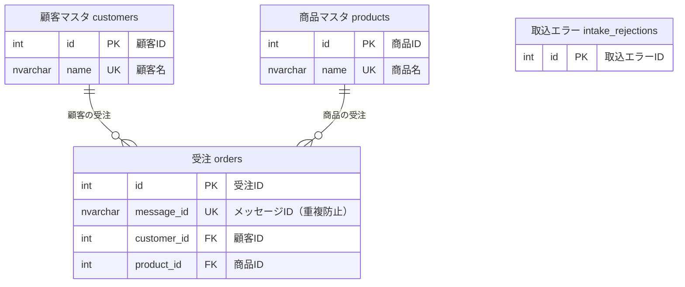

# テーブル定義書

## 文書情報

| 項目 | 内容 |
|---|---|
| 文書名 | テーブル定義書 |
| 文書ID | TD-001 |
| システム名 | 受注メール取り込み・月次帳票システム |
| 版 | 1.3 |
| 作成日 | 2026-11-15 |
| 状態 | 承認済 |

## 改版履歴

| 版 | 日付 | 変更内容 |
|---|---|---|
| 1.0 | 2026-11-15 | 新規作成 |
| 1.1 | 2026-11-15 | ER 図にテーブル・列の論理名（日本語）を併記し、関連線を業務上の意味で表記 |
| 1.2 | 2026-11-15 | ER 図の論理名・関連線の名前を生成後に手で追記している旨と、再生成時の注意を方針に明記 |
| 1.3 | 2026-11-16 | 文章を見直し（ER 図の手での追記方針の文を分割、表記を「インデックス」に統一） |

## 1. 方針

- 正は DDL（`sql/schema_sqlserver.sql`・`sql/schema_sqlite.sql`）とする。本書の各テーブルの節と「2. ER 図」は SQL Server 版 DDL から生成した。生成後に、ER 図の論理名（日本語）を DDL のコメント（MS_Description）に合わせて手で追記している。関連線の名前と列の補足（「重複防止」など）も、業務上の意味に沿って手で追記している。生成器を再実行すると `er:begin`〜`er:end` の内側は物理名だけに戻るため、再実行後は論理名を追記し直す
- 2 つの DDL は列名・制約名・インデックス名をそろえ、違いを型だけにしている（ADR-0001）
- 顧客・商品はメールに書かれた名称を初回出現時に仮登録する。名寄せ（表記揺れの統合）は対象外
- メール本文は保存しない。取込エラーも理由だけを保存する（REQ-011）

## 2. ER 図

<!-- er:begin -->

| 図の名前 | 論理名 | 物理名 | テーブルID |
|---|---|---|---|
| TBL001 | 顧客マスタ | customers | TBL-001 |
| TBL002 | 商品マスタ | products | TBL-002 |
| TBL003 | 受注 | orders | TBL-003 |
| TBL004 | 取込エラー | intake_rejections | TBL-004 |
<!-- er:end -->

図の関連線の名前は業務上の意味で書いている。外部キーの制約名は fk_orders_customer（顧客）・fk_orders_product（商品）で、各テーブルの節に記載している。

テーブルごとの定義は以下の TBL-001〜TBL-004 の各節に記載する（DDL から生成）。

## TBL-001 顧客マスタ（dbo.customers）

| 項目 | 内容 |
|---|---|
| 論理名 | 顧客マスタ |
| 物理名 | dbo.customers |
| 説明 | メールに書かれた顧客名を初回出現時に仮登録する |

### 列定義

| No | 論理名 | 物理名 | データ型 | 桁 | NULL | PK | 既定値 | 備考 |
|---|---|---|---|---|---|---|---|---|
| 1 | 顧客ID | id | int |  | 不可 | 1 |  | IDENTITY(1,1) |
| 2 | 顧客名 | name | nvarchar | 100 | 不可 |  |  |  |
| 3 | 登録日時 | created_at | datetime2 | 0 | 不可 |  |  |  |

### インデックス

なし

### 制約

| No | 制約名 | 種類 | 列 | 内容 |
|---|---|---|---|---|
| 1 | pk_customers | PRIMARY KEY | id |  |
| 2 | uq_customers_name | UNIQUE | name |  |

## TBL-002 商品マスタ（dbo.products）

| 項目 | 内容 |
|---|---|
| 論理名 | 商品マスタ |
| 物理名 | dbo.products |
| 説明 | メールに書かれた商品名を初回出現時に仮登録する |

### 列定義

| No | 論理名 | 物理名 | データ型 | 桁 | NULL | PK | 既定値 | 備考 |
|---|---|---|---|---|---|---|---|---|
| 1 | 商品ID | id | int |  | 不可 | 1 |  | IDENTITY(1,1) |
| 2 | 商品名 | name | nvarchar | 100 | 不可 |  |  |  |
| 3 | 登録日時 | created_at | datetime2 | 0 | 不可 |  |  |  |

### インデックス

なし

### 制約

| No | 制約名 | 種類 | 列 | 内容 |
|---|---|---|---|---|
| 1 | pk_products | PRIMARY KEY | id |  |
| 2 | uq_products_name | UNIQUE | name |  |

## TBL-003 受注（dbo.orders）

| 項目 | 内容 |
|---|---|
| 論理名 | 受注 |
| 物理名 | dbo.orders |
| 説明 | 受注メール1通につき1行 |

### 列定義

| No | 論理名 | 物理名 | データ型 | 桁 | NULL | PK | 既定値 | 備考 |
|---|---|---|---|---|---|---|---|---|
| 1 | 受注ID | id | int |  | 不可 | 1 |  | IDENTITY(1,1) |
| 2 | メッセージID | message_id | nvarchar | 255 | 不可 |  |  |  |
| 3 | 顧客ID | customer_id | int |  | 不可 |  |  | FK → dbo.customers(id) |
| 4 | 商品ID | product_id | int |  | 不可 |  |  | FK → dbo.products(id) |
| 5 | 数量 | quantity | int |  | 不可 |  |  |  |
| 6 | 希望納期 | due_date | date |  | 不可 |  |  |  |
| 7 | 受信日時 | received_at | datetime2 | 0 | 不可 |  |  |  |
| 8 | 抽出方式 | extractor | varchar | 10 | 不可 |  |  |  |
| 9 | 登録日時 | created_at | datetime2 | 0 | 不可 |  |  |  |

### インデックス

| No | インデックス名 | 種類 | 一意 | 列 | 付加列 | 条件 |
|---|---|---|---|---|---|---|
| 1 | ix_orders_received_at | NONCLUSTERED |  | received_at |  |  |
| 2 | ix_orders_customer_id | NONCLUSTERED |  | customer_id |  |  |

### 制約

| No | 制約名 | 種類 | 列 | 内容 |
|---|---|---|---|---|
| 1 | pk_orders | PRIMARY KEY | id |  |
| 2 | uq_orders_message_id | UNIQUE | message_id |  |
| 3 | fk_orders_customer | FOREIGN KEY | customer_id | dbo.customers(id) |
| 4 | fk_orders_product | FOREIGN KEY | product_id | dbo.products(id) |
| 5 | ck_orders_quantity | CHECK |  | (quantity BETWEEN 1 AND 100000) |
| 6 | ck_orders_extractor | CHECK |  | (extractor IN ('llm', 'rule', 'manual')) |

## TBL-004 取込エラー（dbo.intake_rejections）

| 項目 | 内容 |
|---|---|
| 論理名 | 取込エラー |
| 物理名 | dbo.intake_rejections |
| 説明 | 検証に不合格だったメールの記録（本文は保存しない） |

### 列定義

| No | 論理名 | 物理名 | データ型 | 桁 | NULL | PK | 既定値 | 備考 |
|---|---|---|---|---|---|---|---|---|
| 1 | 取込エラーID | id | int |  | 不可 | 1 |  | IDENTITY(1,1) |
| 2 | メッセージID | message_id | nvarchar | 255 | 可 |  |  |  |
| 3 | 検出元 | source | varchar | 20 | 不可 |  |  |  |
| 4 | エラー内容 | errors | nvarchar | 2000 | 不可 |  |  |  |
| 5 | 登録日時 | created_at | datetime2 | 0 | 不可 |  |  |  |

### インデックス

| No | インデックス名 | 種類 | 一意 | 列 | 付加列 | 条件 |
|---|---|---|---|---|---|---|
| 1 | ix_intake_rejections_created_at | NONCLUSTERED |  | created_at |  |  |

### 制約

| No | 制約名 | 種類 | 列 | 内容 |
|---|---|---|---|---|
| 1 | pk_intake_rejections | PRIMARY KEY | id |  |

## 3. SQLite と SQL Server の対応

| 項目 | SQLite（開始時） | SQL Server（移行先） | 移行時の注意 |
|---|---|---|---|
| 主キーの採番 | `INTEGER PRIMARY KEY AUTOINCREMENT` | `INT IDENTITY(1,1)` | 採番値の取得は `lastrowid` → `OUTPUT INSERTED.id` |
| 日本語の文字列 | `VARCHAR(n)`（中身は UTF-8） | `NVARCHAR(n)` | 文字数の上限は API の検証（コードポイント単位）と一致 |
| 日時 | `VARCHAR(19)`（ISO 8601、JST） | `DATETIME2(0)` | 文字列のまま範囲比較できる形式で保存しているため、変換は `CONVERT(DATETIME2, ...)` のみ |
| 日付 | `VARCHAR(10)`（YYYY-MM-DD） | `DATE` | 同上 |
| 一意制約違反 | `sqlite3.IntegrityError` | エラー番号 2627 / 2601 | `app/db.py` の `insert_order` の 1 か所で吸収 |
| 月の絞り込み | `received_at >= ? AND received_at < ?` | 同じ | 方言関数（`strftime`・`FORMAT`）を使わないため変更不要。インデックスも使える |
| 論理名 | なし（DDL のコメント） | `MS_Description` 拡張プロパティ | — |

### 3.1 移行の手順（想定）

1. `sql/schema_sqlserver.sql` を検証用 DB で実行する（本リポジトリでは未実行）
2. SQLite から CSV で書き出し、`bcp` などで顧客・商品・受注・取込エラーの順に投入する（外部キーの順序）
3. `IDENTITY_INSERT` を有効にして ID を維持し、投入後に件数と数量合計を突き合わせる
4. `app/db.py` の接続を pyodbc に切り替え、自動テストを SQL Server に向けて実行する
