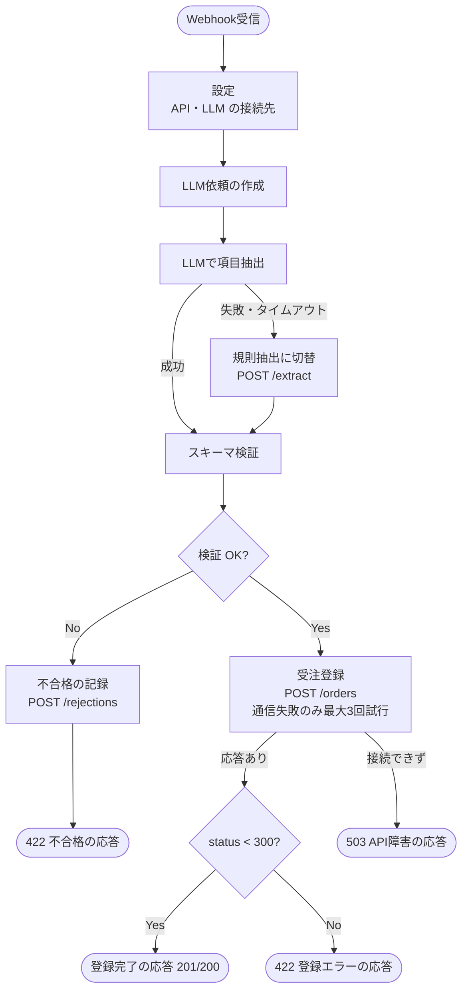
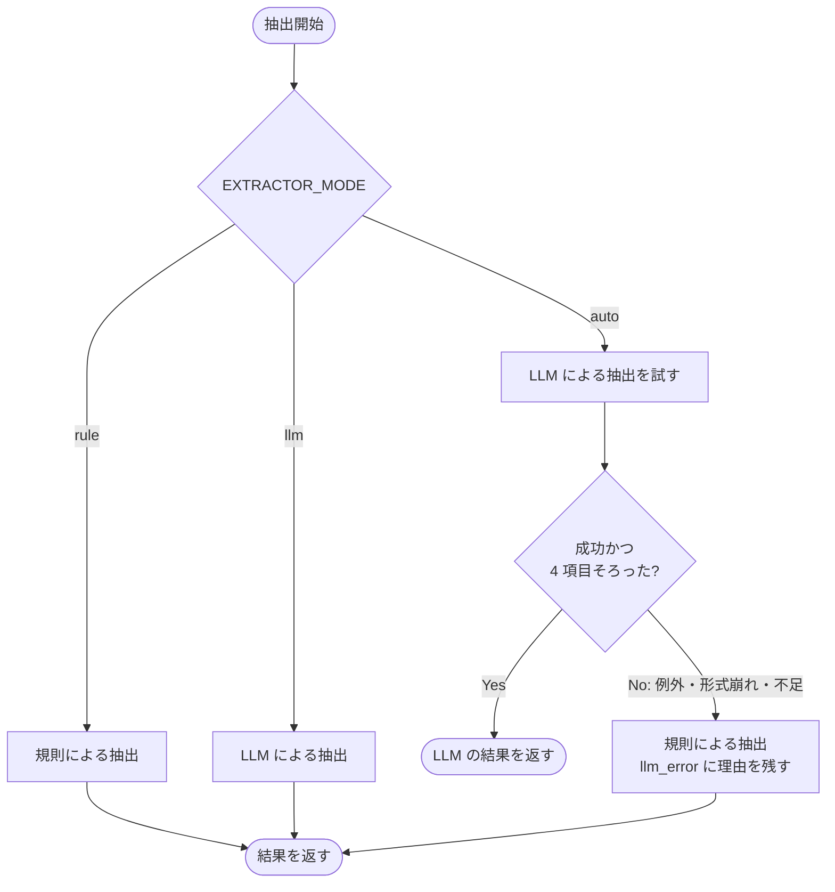
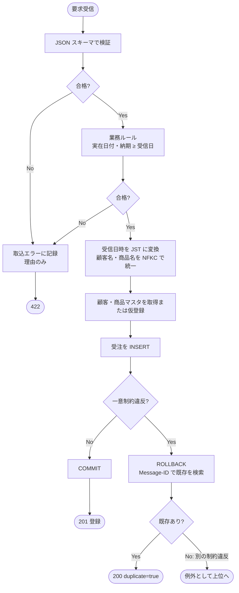
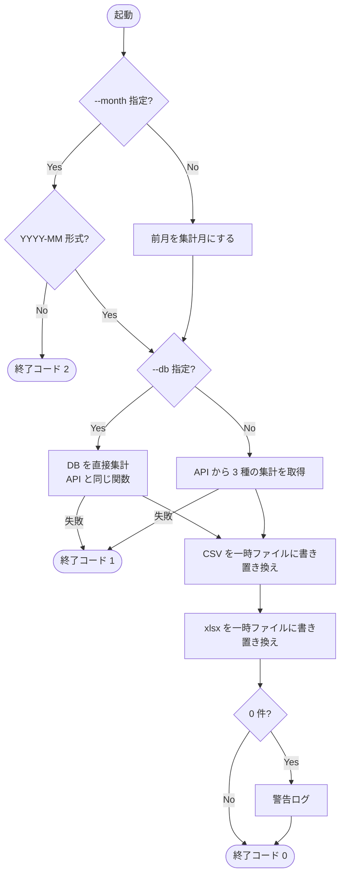

# 詳細設計書

## 文書情報

| 項目 | 内容 |
|---|---|
| 文書名 | 詳細設計書 |
| 文書ID | DD-001 |
| システム名 | 受注メール取り込み・月次帳票システム |
| 版 | 1.3 |
| 作成日 | 2026-11-15 |
| 状態 | 承認済 |

## 改版履歴

| 版 | 日付 | 変更内容 |
|---|---|---|
| 1.0 | 2026-11-15 | 新規作成 |
| 1.1 | 2026-11-15 | CSV・xlsx・帳票の数式の無害化、n8n の実行履歴の設定を追記 |
| 1.2 | 2026-11-16 | 例外表を実装に合わせて修正（ERR-006 の範囲、規則抽出の通信失敗、帳票マクロの空の CSV） |
| 1.3 | 2026-11-16 | 文章を見直し（表記ゆれを修正）。API の通信失敗時の回数を n8n の設定どおり「最大 3 回試行（初回を含む）」に修正（処理の流れ図・例外表） |

## FN-001 受注メール取込フロー

- 関連要件：REQ-001, REQ-002, REQ-008, REQ-010
- 実装：`n8n/order-intake.json`（`tools/build_n8n_workflow.py` で生成）。ノードごとの設定は flows/FLW-001_受注メール取込.md
- スキーマ検証ノードには `app/order_schema.json` を埋め込む。生成スクリプトで作り直し、一致をテスト（TC-026）と CI で確認する

## FN-002 受注項目の抽出

- 関連要件：REQ-001, REQ-008
- 実装：`app/extractor.py`

### 規則による抽出

1. 本文を NFKC で正規化する（全角数字・全角コロンを半角にし、正規表現を 1 種類で済ませる）
2. 項目名で探す。`項目名：値` と `【項目名】値` の両方を受け付け、行頭の記号（・ - ■）は無視する

| 項目 | 項目名として認める語 |
|---|---|
| 顧客名 | 顧客名、会社名、御社名、貴社名、発注者、発注元、注文者 |
| 商品 | 商品名、商品、品名、品目、注文商品 |
| 数量 | 数量、個数、注文数（数字以外の単位は捨てる。カンマ区切り可） |
| 希望納期 | 希望納期、納期、納品希望日、希望納品日、お届け希望日 |

3. 顧客名の項目がない場合は署名の会社名（株式会社・有限会社・合同会社を含む語）を使う。宛名（「御中」「様」を含む行）は当社なので除き、末尾に近いものを採る
4. 日付は「YYYY年M月D日」「YYYY/M/D」「M月D日」「M/D」を受け付ける。年がなければ受信日の年を補い、受信日より前になる場合は翌年とする。存在しない日付は取り出せなかった扱いにする

### LLM による抽出と切替

- Ollama の `format` に JSON スキーマを渡し、JSON 以外を返させない。`temperature` は 0
- 抽出結果は登録前に必ず FN-003 の検証を通す。抽出方式は `extractor` 列に残す

## FN-003 受注登録（検証・重複判定）

- 関連要件：REQ-001, REQ-002, REQ-003, REQ-009, REQ-011
- 実装：`app/main.py` の `register_order`、`app/validation.py`、`app/db.py` の `insert_order`

- 重複判定を「SELECT してから INSERT」にしない理由：同じメールが同時に届いた場合に両方が未登録と判定されるため。一意制約違反で判定する（ADR-0003、TC-004 で 8 並列を確認）
- マスタの仮登録も同じ考え方で、INSERT の一意制約違反時は既存行を引き直す

## FN-004 メール取込 API

- 関連要件：REQ-001, REQ-008, REQ-010
- 入力の検査（本文必須・20,000 文字まで・Message-ID の形式・日時の形式）→ 登録済みなら抽出せず 200 → FN-002 → FN-003
- `/extract` は抽出だけを行い登録しない。n8n の LLM 失敗時の代替経路として使う

## FN-005 受注一覧

- 関連要件：REQ-004
- 月（範囲条件）と顧客名で絞り込み、受信日時順に返す。件数は 1〜1,000（既定 100）

## FN-006 月次集計 API

- 関連要件：REQ-005, REQ-013
- `GROUP BY` の列は許可した 3 通り（顧客×商品・顧客・商品）の対応表から選ぶ。利用者の入力から SQL の列名を組み立てない
- 月は `received_at >= 月初 AND received_at < 翌月初` で絞る。方言関数を使わないため SQL Server でもそのまま動き、インデックスも使える

## FN-007 取込エラーの記録

- 関連要件：REQ-002, REQ-011
- 記録する内容は Message-ID・検出元（api ／ intake ／ n8n）・理由（最大 10 件、各 200 文字）・登録日時。本文は記録しない

## FN-008 月次集計バッチ

- 関連要件：REQ-006
- 実装：`batch/monthly_report.py`、`batch/run_monthly.ps1`

- 一時ファイルに書いてから置き換えるのは、書き込み途中のファイルを帳票マクロや共有フォルダの利用者が開かないようにするため
- 顧客名・商品はメール由来の外部入力のため、数式の先頭文字（`=` `+` `-` `@` タブ・改行）で始まる値は CSV では先頭に `'` を付け、xlsx では文字列型に固定する。全角の `＝` も登録時の NFKC で `=` になるため同じ扱いになる

## FN-009 月次帳票作成

- 関連要件：REQ-007
- 実装：`src/MonthlyReport.bas`
- 処理：CSV を ADODB.Stream で UTF-8 として読む → 見出し行を照合 → ファイル名から集計月を取得 → テンプレートシートを複製（同じ月は置き換え）→ 明細と顧客ごとの小計・総合計 → 罫線・数値書式・印刷設定
- テンプレートシートがなければ最低限の様式を作る。既にあれば利用者が整えた様式を変更しない
- 印刷設定はプリンタ未設定の PC で実行時エラーになるため、失敗を無視する
- 顧客名・商品・小計の見出しは書式を文字列（`@`）にし、数式の先頭文字で始まる値には `'` を付けて書き込む（無害化されていない CSV を渡されても数式として動かない）

## 例外・エラー処理

| 発生箇所 | 事象 | 処理 | 利用者への見え方 | ログ |
|---|---|---|---|---|
| FN-003 | 検証エラー | 登録せず取込エラーに記録 | 422（ERR-001） | WARNING |
| FN-003 | Message-ID の重複 | 既存を返す | 200 duplicate=true | INFO |
| FN-003 | 重複以外の制約違反 | 例外を上位へ | 500（ERR-004） | ERROR（uvicorn） |
| FN-002 | LLM の停止・形式崩れ・不足（auto） | 規則による抽出に切替 | 通常どおり（extractor=rule） | WARNING（理由） |
| FN-001 | LLM の失敗 | `/extract` に切替（ERR-008） | 通常どおり | n8n 実行履歴 |
| FN-001 | n8n のスキーマ検証で不合格 | `/rejections` に記録 | 422（ERR-005） | n8n 実行履歴、取込エラー |
| FN-001 | API が登録を受け付けない（検証の不合格、500 など状態コード 300 以上） | 検証の不合格は API が取込エラーに記録。元の状態コードを `status` に入れて応答 | 422（ERR-006） | WARNING（検証の不合格）／ERROR（500） |
| FN-001 | API の通信失敗 | 最大 3 回試行した後に 503 | 503（ERR-007） | n8n 実行履歴 |
| FN-001 | LLM の失敗後、規則抽出（`/extract`）も通信できない | エラー時の分岐を持たないため、実行が失敗として止まる（応答ノードを通らない） | n8n の既定のエラー応答 | n8n 実行履歴（失敗） |
| FN-004 | 本文が長すぎる | 受け付けない | 413（ERR-002） | — |
| FN-005, FN-006 | パラメータの形式誤り | 受け付けない | 422（ERR-003） | — |
| FN-008 | API・DB に接続できない | 中断 | 終了コード 1 | ERROR |
| FN-008 | 集計月の形式誤り | 中断 | 終了コード 2 | ERROR |
| FN-009 | CSV が空 | 中断 | メッセージ表示（「CSV が空です」） | — |
| FN-009 | 見出し行が想定と異なる | 中断（列ずれの取り込み防止） | メッセージ表示 | — |
| FN-009 | 列数が 5 でない行 | 中断（行番号を表示） | メッセージ表示 | — |
| FN-009 | ファイル名から月を読めない | 中断 | メッセージ表示 | — |

## ログ方針

| 対象 | 出力先 | 内容 | 出さないもの |
|---|---|---|---|
| 受注 API | 標準出力（Docker ではコンテナログ） | 登録・重複・検証エラー件数・LLM 切替の理由。レベルは `LOG_LEVEL`（既定 INFO） | メール本文、顧客名以外の個人に関わる情報 |
| n8n | n8n の実行履歴 | ノードごとの入出力 | — （実行履歴の保存期間は n8n 側で設定する） |
| 月次バッチ | 標準出力、PowerShell ラッパーは `output/logs/monthly_YYYYMMDD_HHMMSS.log` | 集計月・件数・出力先・失敗理由 | — |

n8n の実行履歴にはメール本文が残るため、フローの設定で成功時の履歴を保存しない（`saveDataSuccessExecution: none`）。失敗時の履歴は原因調査のため保存する（`saveDataErrorExecution: all`）ので、保存期間は n8n 側（実行データの自動削除の設定）で短くする。
