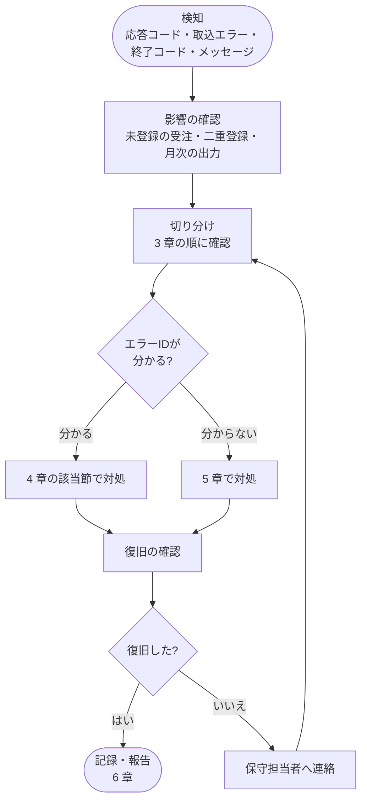

# 障害対応手順書

## 文書情報

| 項目 | 内容 |
|---|---|
| 文書名 | 障害対応手順書 |
| 文書ID | OP-INC-001 |
| システム名 | 受注メール取り込み・月次帳票システム |
| 版 | 1.1 |
| 作成日 | 2026-11-16 |
| 状態 | 承認済 |

## 改版履歴

| 版 | 日付 | 変更内容 |
|---|---|---|
| 1.0 | 2026-11-16 | 新規作成 |
| 1.1 | 2026-11-16 | ERR-006 の範囲を設計書に合わせ、n8n 経由で API が 500 などを返した場合も ERR-006 として記録するよう修正 |

## 1. 目的と対象

本書は、受注メールの取り込み・月次集計・月次帳票の作成で障害が起きたときに、原因を切り分けて復旧し、記録を残すための手順を定める。

| 項目 | 内容 |
|---|---|
| 使う人 | 運用担当者（一次対応）、保守担当者（コード・設定の修正を伴う二次対応）。役割と連絡の順は 08_運用設計.md の「8. 連絡体制」による |
| 使うとき | Webhook の応答が 2xx 以外のとき、取込エラー（`GET /rejections`）が増えたとき、月次集計の終了コードが 0 以外のとき、帳票マクロがメッセージを出して止まったとき、日々の確認（08_運用設計.md の 2 章）で異常を見つけたとき |
| 対象 | n8n 取込フロー（FN-001）、受注 API（FN-002〜FN-007）、月次集計バッチ（FN-008）、帳票マクロ（FN-009）、DB（SQLite） |
| 対象外 | 取引先のメールサーバ・n8n や Ollama 自体の不具合の修正、SQL Server 移行後の DB 障害（移行時に本書を改訂する）、顧客名・商品名の名寄せ（要件定義書の対象外） |

エラーID（ERR-001〜ERR-008）の定義は 05_インターフェース設計.md の 2.5・3.1、発生箇所と処理は 06_詳細設計.md の「例外・エラー処理」にある。本書はその ID ごとに対応手順を書く。

## 2. 障害時の基本の流れ



- 影響の確認では、まず「登録されるべき受注が登録されていないか」「同じ受注が二重に登録されていないか」を確認する。二重登録は Message-ID の一意制約で防いでいるため、再送で二重になることはない（ADR-0003）
- データを直す作業（手での登録、DB の戻し）を行う前に、08_運用設計.md の 4 章の手順で DB の複製を取る

## 3. 切り分けの順番

上から順に確認し、異常が見つかった時点で、表の「異常なときの行き先」に示す 4 章・5 章の該当箇所へ進む。接続先は既定の構成（API は `http://localhost:8000`、n8n は `http://localhost:5678`、Ollama は `http://localhost:11434`）で書く。別の構成では読み替える。

| 順 | 確認すること | 確認コマンド・場所 | 正常なときの結果 | 異常なときの行き先 |
|---|---|---|---|---|
| 1 | 受注 API が動いているか | `curl -s http://localhost:8000/health`。Docker では `docker compose ps` の api の状態 | `{"status":"ok"}`。Docker では healthy | ERR-007、5 章 5.1 |
| 2 | API のログに警告・エラーがないか | Docker は `docker compose logs --since 24h api`、venv は uvicorn を起動したターミナルの出力 | `order created` ／ `order duplicate` の INFO だけ | 下表の文言で判断 |
| 3 | 取込エラーが増えていないか | `curl -s "http://localhost:8000/rejections?limit=50"`（新しい順。`source` と `errors` を見る） | 前回の確認から増えていない | ERR-001、ERR-005 |
| 4 | n8n の失敗実行がないか | n8n の画面の実行履歴を Error で絞り込む。成功時の履歴は保存しない設定のため、残っているのは失敗だけ | 失敗実行がない | 失敗したノード名で判断（4 章） |
| 5 | LLM が動いているか（LLM を使う構成のみ） | `curl -s http://localhost:11434/api/tags` で、使うモデル（既定 `qwen2.5:7b`）が一覧にあるか | モデル名が表示される | ERR-008 |
| 6 | 月次集計が正常に終わったか | タスクスケジューラの前回の結果、`output/logs/monthly_YYYYMMDD_HHMMSS.log`（PowerShell ラッパー）、cron の例では `output/monthly.log` | 終了コード 0、ログに `出力しました` | 5 章 5.6 |
| 7 | DB ファイルが読めるか | `sqlite3 data/orders.db "PRAGMA integrity_check;"`（API を止めてから実行） | `ok` | 5 章 5.4 |

受注 API のログで見るべき文言（`app/main.py` の出力どおり）：

| 文言 | レベル | 意味 | 関連 |
|---|---|---|---|
| `order created message_id=...` | INFO | 新規登録 | — |
| `order duplicate message_id=...` | INFO | 登録済みのため既存を返した | — |
| `order duplicate (skipped extraction) message_id=...` | INFO | `/intake/email` で登録済みのため抽出せずに返した | — |
| `validation failed message_id=... errors=N` | WARNING | 検証で不合格。取込エラーに記録した | ERR-001、ERR-006 |
| `LLM fallback message_id=... reason=...` | WARNING | `/intake/email` で LLM が失敗し、規則による抽出に切り替えた（`EXTRACTOR_MODE=auto` のとき） | ERR-008 |
| `Exception in ASGI application` などの例外の出力 | ERROR（uvicorn） | 想定外の例外 | ERR-004 |

n8n 経由の取り込みでは、LLM から規則抽出への切替は n8n の中で行うため、API のログに `LLM fallback` は出ない（`/extract` はログを出さない）。n8n 経由の切替は、登録された受注の `extractor` 列（`rule`）で確認する。

## 4. エラー別の対応手順

### 4.1 ERR-001 API の検証エラー

| 項目 | 内容 |
|---|---|
| 事象 | `POST /orders`・`POST /intake/email` が 422 を返す。応答は `{"detail": {"errors": [{"field": "数量", "message": "必須項目がありません"}]}}` の形で、項目と理由が入る |
| 影響 | その受注は登録されない。取込エラー（`intake_rejections`）に Message-ID・検出元（`api` または `intake`）・理由が記録される。既存のデータは壊れない |
| 想定原因 | メールに必須項目（顧客名・商品・数量・希望納期）が書かれていない、抽出で読み取れなかった、値が規則の範囲外（数量 1〜100,000 など）、希望納期が実在しない日付か受信日より前 |
| 確認すること | `curl -s "http://localhost:8000/rejections?limit=50"` で該当の Message-ID の `errors` を見る。API のログの `validation failed`。元のメールの本文 |
| 対処 | 元のメールを見て正しい値を確認し、`POST /orders` で手で登録する（下の例）。`message_id` には元のメールの Message-ID をそのまま入れ、`extractor` は `manual` にする。メールの内容そのものに不備がある場合は、取引先への確認を業務担当に依頼する。同じ書き方の不合格が続く場合は、規則による抽出の項目名の追加を保守担当者に依頼する |
| 復旧の確認 | 手で登録した要求が 201 を返し、`curl -s "http://localhost:8000/orders?month=YYYY-MM"` に該当の受注が出る |
| 再実行してよいか | 同じメールをそのまま再送しても同じ理由で不合格になる（新たな取込エラーが 1 件増える）。手での登録は、元の Message-ID を使えば後から同じメールが再送されても 200（重複）になり、二重登録にならない |
| 関連 | FN-003、FN-004、FN-007、TC-005、TC-006、TC-024 |

手での登録の例（値は 05_インターフェース設計.md 2.2 の要求例）：

```bash
curl -s -X POST http://localhost:8000/orders \
  -H "Content-Type: application/json" \
  -d '{"message_id": "<20261102.0915.a1@mail.example.com>", "customer_name": "サンプル商事株式会社",
       "product": "A4コピー用紙（500枚×5冊）", "quantity": 20, "due_date": "2026-11-10",
       "received_at": "2026-11-02T09:15:00+09:00", "extractor": "manual"}'
```

### 4.2 ERR-002 本文の文字数超過

| 項目 | 内容 |
|---|---|
| 事象 | `POST /intake/email`・`POST /extract` が 413 を返す。応答の `detail` は「メール本文が長すぎます（20,000 文字まで）」 |
| 影響 | その受注は登録されない。取込エラーには記録されない（入力の検査で受け付けないため）。既存のデータは壊れない |
| 想定原因 | 本文に添付ファイルの内容・過去のやり取りの引用が大量に貼り付けられている |
| 確認すること | 元のメールの本文の長さと内容 |
| 対処 | 注文に必要な部分が分かる場合は、ERR-001 の例と同じ手順で `POST /orders` で手で登録する。添付ファイル（PDF・Excel の注文書）の読み取りは対象外のため、手で登録する |
| 復旧の確認 | 手で登録した要求が 201 を返す |
| 再実行してよいか | 同じ本文を再送しても 413 になる。手での登録は元の Message-ID を使えば二重登録にならない |
| 関連 | FN-004、TC-025 |

n8n 経由では `/extract` は LLM が失敗したときだけ呼ばれる。その呼び出しが 413 になった場合は「規則抽出に切替」ノードで実行が止まる（5 章 5.2 と同じ扱い）。

### 4.3 ERR-003 パラメータの形式誤り

| 項目 | 内容 |
|---|---|
| 事象 | `GET /orders`・`GET /reports/monthly` が 422 を返す（`month` が `YYYY-MM` でない、`group_by` が許可した値でない、`limit` が 1〜1,000 の範囲外）。`POST /rejections` が 422 を返す（応答の `detail` は「errors（1件以上の配列）と source（英小文字20字以内）が必要です」または「message_id は文字列で指定してください」） |
| 影響 | 一覧・集計の取得（参照系）は結果が返らないだけで、データは変わらない。`POST /rejections` の場合、その取込エラーは記録されない |
| 想定原因 | 呼び出し側の不具合（手で打ったコマンドの誤り、n8n の「不合格の記録」ノードの送信内容の誤り） |
| 確認すること | 送った URL・本文。月次バッチから呼ばれた場合はバッチのログ（集計月の形式はバッチ側で先に検査するため、通常は起きない） |
| 対処 | 呼び出し側を直す。n8n のノードの不具合の場合は、`tools/build_n8n_workflow.py` を直してフローを作り直すよう保守担当者に依頼する |
| 復旧の確認 | 同じ要求が 200（`POST /rejections` は 201）を返す |
| 再実行してよいか | よい。一覧・集計の取得（参照系）はデータを変更しないため、何度実行しても影響はない。`POST /rejections` は再実行のたびに 1 件ずつ記録が増える（重複の排除はしない） |
| 関連 | FN-005、FN-006、FN-007、TC-011、TC-013、TC-014 |

### 4.4 ERR-004 想定外のエラー

| 項目 | 内容 |
|---|---|
| 事象 | API を直接呼び出したときに 500 が返る。n8n 経由では「登録エラーの応答」ノードが 422 で `{"stage":"api","status":500,"detail":...}` を返し、エラーIDは ERR-006 として記録する（4.6）。原因の確認と対処は本節に従う |
| 影響 | 登録処理は途中で失敗すると全体を取り消す仕組み（トランザクション）で行うため、受注が中途半端に登録されることはない。その受注は登録されていない |
| 想定原因 | DB ファイルに書けない（権限・ディスク不足）、同時書き込みで 10 秒待っても書けない（SQLite のロック）、Message-ID 以外の制約違反（06_詳細設計.md FN-003 の「別の制約違反」）、コードの不具合 |
| 確認すること | API のログの例外の出力（例外の種類と文言）。`df -h`（DB を置いたディスクの空き）。DB ファイルとフォルダの書き込み権限。Docker ではボリューム `order-data` の状態 |
| 対処 | ディスクの空きを作る、権限を直す。ロックが原因で一時的なものなら、そのまま再送する。例外が繰り返し出る場合はログを添えて保守担当者に連絡する |
| 復旧の確認 | 同じ要求を再送して 201 または 200（重複）が返る。ログに例外が出なくなる |
| 再実行してよいか | よい。登録系は Message-ID の一意制約により、同じ要求を何度送っても結果が変わらない（冪等）ため、再送しても二重登録にならない |
| 関連 | FN-003、FN-004、TC-008 |

### 4.5 ERR-005 n8n のスキーマ検証で不合格

| 項目 | 内容 |
|---|---|
| 事象 | Webhook が 422 で `{"stage":"validation","errors":[...]}` を返す |
| 影響 | その受注は登録されない。API の `/rejections` に `source=n8n` で理由が記録される。ただし「不合格の記録」ノードはエラーでも続行する設定のため、API が止まっていると記録されないまま 422 が返る |
| 想定原因 | メールに必須項目が書かれていない、LLM・規則のどちらでも読み取れなかった。LLM が応答を返したが内容が JSON として読めなかった場合も、n8n では規則抽出に切り替えずこの不合格になる（切り替えるのは LLM の呼び出し自体が失敗・タイムアウトしたときだけ） |
| 確認すること | `curl -s "http://localhost:8000/rejections?limit=50"` で `source` が `n8n` の記録の `errors`。記録がない場合は API の稼働（3 章の順 1）。元のメールの本文 |
| 対処 | ERR-001 と同じく、元のメールを見て `POST /orders` で手で登録する。読み取れたはずの項目が不合格になっている場合は、LLM のモデルや応答の変化を疑い、保守担当者に連絡する |
| 復旧の確認 | 手で登録した要求が 201 を返す。取込エラーの記録が抜けていた場合は、記録が必要なら `POST /rejections` で `source=n8n` を付けて記録する |
| 再実行してよいか | 同じメールを再送すると、同じ内容なら再び 422 になり、取込エラーが 1 件増える。手での登録は元の Message-ID を使えば二重登録にならない |
| 関連 | FN-001、FN-007、TC-030、TC-031 |

### 4.6 ERR-006 n8n 経由で API が登録を受け付けない

| 項目 | 内容 |
|---|---|
| 事象 | Webhook が 422 で `{"stage":"api","status":422,"detail":...}` を返す（例：`"希望納期"`・`"受信日より前の日付です"`）。`status` が 500 など 422 以外のときも ERR-006 として記録し、原因の確認と対処は 4.4（ERR-004）に従う |
| 影響 | その受注は登録されない。API 側で取込エラーに `source=api` で記録される。既存のデータは壊れない |
| 想定原因 | n8n の検証（JSON スキーマ）は通ったが、API の業務ルール（実在する日付・納期が受信日以降）で不合格になった |
| 確認すること | 応答の `detail`。`GET /rejections` の `source=api` の記録。API のログの `validation failed` |
| 対処 | ERR-001 と同じ。元のメールで希望納期を確認し、正しい値で手で登録する |
| 復旧の確認 | 手で登録した要求が 201 を返す |
| 再実行してよいか | 同じメールの再送は同じ理由で不合格になる。手での登録は元の Message-ID を使えば二重登録にならない |
| 関連 | FN-001、FN-003、TC-032 |

### 4.7 ERR-007 受注 API に接続できない

| 項目 | 内容 |
|---|---|
| 事象 | Webhook が 503 で `{"stage":"api","message":"受注 API に接続できませんでした"}` を返す。n8n の実行履歴に「受注登録」ノードの失敗が残る |
| 影響 | 「受注登録」ノードは通信の失敗時に 2 秒間隔で最大 3 回試し、すべて失敗すると 503 を返す。応答待ちが 30 秒を超えた場合も失敗として扱うため、API 側では登録が済んでいて、応答だけが返らなかった可能性がある |
| 想定原因 | 受注 API の停止、n8n「設定」ノードの `api_url` の誤り（Docker の n8n から同じ PC の API へは `host.docker.internal`）、API の処理の遅れ |
| 確認すること | 3 章の順 1（`/health`）。n8n「設定」ノードの `api_url`。n8n のコンテナから API に届くか |
| 対処 | API を起動する（`docker compose up -d`、venv では `uvicorn app.main:app --port 8000`）。接続先が誤っていれば「設定」ノードを直す |
| 復旧の確認 | `/health` が `{"status":"ok"}` を返し、同じメールを再送して 201 または 200（重複）が返る |
| 再実行してよいか | よい。同じメールを Webhook に再送する。API 側で登録が済んでいた場合も 200（`duplicate: true`）で既存の受注が返り、二重登録にならない |
| 関連 | FN-001、TC-033 |

### 4.8 ERR-008 LLM の失敗による規則抽出への切替

| 項目 | 内容 |
|---|---|
| 事象 | エラーの応答は出ない。n8n では「LLMで項目抽出」が失敗・タイムアウト（120 秒）すると `POST /extract?mode=rule` に切り替え、登録された受注の `extractor` が `rule` になる。API の `/intake/email`（`EXTRACTOR_MODE=auto`）では同じ切替でログに `LLM fallback` が出る |
| 影響 | 取り込みは止まらない。規則で読み取れない文章形式のメールは不合格（ERR-005 または ERR-001）になり、取込エラーに記録される。誤った受注が黙って登録されることはない |
| 想定原因 | Ollama の停止、モデル未取得、接続先（n8n「設定」の `ollama_url`、API の `OLLAMA_URL`）の誤り、PC の負荷による応答の遅れ |
| 確認すること | 3 章の順 5（`/api/tags`）。`curl -s "http://localhost:8000/orders?month=YYYY-MM"` で `extractor` が `rule` の受注が増えていないか。API のログの `LLM fallback ... reason=...` |
| 対処 | Ollama を起動し、モデルを取得する（`ollama pull qwen2.5:7b`）。接続先を直す |
| 復旧の確認 | 新しく届いたメールの受注が `extractor=llm` で登録される |
| 再実行してよいか | 登録済みの受注は再実行不要（再送しても 200 の重複になるだけで、`extractor` は書き換わらない）。切替中に不合格になったメールは、LLM の復旧後に同じメールを再送すれば登録できる（未登録のため二重登録にならない） |
| 関連 | FN-001、FN-002、TC-021、TC-022、TC-031 |

## 5. エラーIDの付かない障害

### 5.1 受注 API・n8n の停止

| 項目 | 内容 |
|---|---|
| 事象 | API が止まると、n8n 経由では ERR-007、直接呼ぶ経路（`/intake/email`・月次バッチ）では接続できない。n8n が止まると、Webhook の送り手が接続できない |
| 確認すること | `docker compose ps`、`curl -s http://localhost:8000/health`、n8n の画面が開くか |
| 対処 | `docker compose up -d`（n8n も使う場合は `docker compose --profile n8n up -d`）。API のコンテナは `restart: unless-stopped` のため、Docker 自体が動いていれば自動で再起動する |
| 再実行 | 停止中に届いたメールは、送り手側で再送する（Webhook の場合）。登録済みのものは 200（重複）になるため、どこまで届いたか分からない場合はまとめて再送してよい |

### 5.2 LLM と受注 API が同時に使えない

「LLMで項目抽出」が失敗した後、「規則抽出に切替」ノード（`POST /extract`）はエラー時の分岐を持たないため、実行がそのノードで止まり、n8n の実行履歴に Error として残る。応答ノードを通らないため、ERR-005〜ERR-007 の応答は返らない。API と Ollama を復旧させてから、同じメールを再送する（未登録のため二重登録にならない）。

### 5.3 ディスク不足

DB に書けなくなり API は 500（ERR-004）を返す。月次バッチは CSV・xlsx を書けず終了コード 1 になる。`df -h` で空きを確認し、古い月次の出力・ログ・DB の複製（保管期間を過ぎたもの）を整理する。DB の複製を削除する前に、残す世代を確認する。

### 5.4 DB ファイルの破損・誤削除

`PRAGMA integrity_check;` が `ok` を返さない、または `data/orders.db` がない場合。API は起動時に DB がなければ空の DB を作るため、誤削除に気づかず空の DB で動き続けることがある（`GET /orders` が 0 件になる）。08_運用設計.md の 4 章の手順で、直近の複製に戻す。複製を取った後に届いたメールは、送り手側で再送して登録し直す（登録済みのものは重複として返る）。

### 5.5 入力の形式誤り（`/intake/email`・`/extract`）

本文がない、`message_id` が空白を含む・3〜255 文字でない（`/intake/email` のみ）、`received_at` が ISO 8601 でない場合、API は 422 を返す。応答の `detail` は「body（メール本文）が必要です」「message_id（空白を含まない 3〜255 文字）が必要です」「received_at は ISO 8601 形式で指定してください」。この 422 は取込エラーに記録されない。送り手（メールサーバとの連携・n8n の「LLM依頼の作成」ノード）の不具合として直す。

### 5.6 月次集計バッチの失敗

| 終了コード | ログの文言 | 想定原因 | 対処 |
|---|---|---|---|
| 1 | `集計の取得に失敗しました: ...` | API の停止・接続先の誤り、`--db` に指定した DB ファイルがない、出力先に書けない | API を起動して再実行する。API を起動できない場合は `python -m batch.monthly_report --db data/orders.db --month YYYY-MM` で DB を直接読む（PowerShell ラッパーは `--db` を渡せないため、直接実行する） |
| 2 | `集計月の形式が正しくありません: ...（YYYY-MM）` | `--month`（ラッパーは `-Month`）の形式誤り | `YYYY-MM` で指定し直す |
| 0 | `... の受注は 0 件です（見出しだけの CSV を出力しました）`（WARNING） | 対象月に受注がない、または DB が空（5.4） | 想定どおりか `GET /orders?month=YYYY-MM` で確認する |

再実行してよい。CSV・xlsx は一時ファイルに書いてから置き換えるため、失敗しても前回の出力が中途半端に壊れることはない。同じ月を再実行すると出力は上書きされる。

### 5.7 帳票マクロのメッセージ

マクロは「帳票を作成できませんでした。」に続けて理由を表示して止まる。

| 表示される理由 | 対処 |
|---|---|
| `CSV の見出しが想定と異なります: ...` | 別のファイル・古い形式の CSV を選んでいる。`monthly_orders_YYYY-MM.csv` を選び直す |
| `列数が正しくありません（N 行目）` | CSV が手で編集されている。月次集計を再実行して CSV を作り直す |
| `ファイル名から集計月を読み取れません: ...` | ファイル名を変えている。`monthly_orders_YYYY-MM.csv` の名前に戻す |
| `CSV が空です` | 0 バイトのファイルを選んでいる。月次集計を再実行する |

同じ月で再実行すると、帳票シートは置き換えられる（二重にはならない）。

### 5.8 外部の仕様・書式の変化

- 取引先がメールの書き方を変えた：同じ取引先の取込エラーが続けて増える。規則の項目名の追加（06_詳細設計.md FN-002 の表）を保守担当者に依頼する
- LLM のモデル・Ollama の版を変えた：読み取れていた項目が不合格になる（ERR-005）。元のモデルに戻すか、変更後のモデルで抽出のテスト（TC-023 の手順）を行う
- Gmail Trigger に差し替えた場合、Gmail の出力項目名は n8n の版によって異なる（05_インターフェース設計.md 3.2）。n8n の更新後に取り込みが止まった場合はここを確認する

## 6. 障害の記録と報告

障害ごとに次の項目を記録する。記録の保管場所・保管期間は運用で決める項目とする。

| 項目 | 書く内容 |
|---|---|
| 発生日時 | 最初に事象が起きた日時（分かる範囲で）と、検知した日時 |
| 検知方法 | Webhook の応答、日々の確認、取込エラーの増加、バッチの終了コード、利用者からの連絡 など |
| エラーID | ERR-001〜ERR-008。付かない場合は「なし（5 章の該当節）」 |
| 影響範囲 | 未登録になった受注の件数と Message-ID、二重登録の有無、月次の出力への影響 |
| 原因 | 確定した原因。確定していなければ「調査中」とし、分かっている事実を書く |
| 対処 | 行った操作（再送・手での登録・再起動・DB の戻し）と、その結果 |
| 再発防止 | 規則の追加、監視・確認の追加、設定の変更など。不要ならその理由 |

報告のひな形：

```markdown
## 障害報告

- 発生日時：YYYY-MM-DD hh:mm（検知：YYYY-MM-DD hh:mm）
- 検知方法：
- エラーID：
- 影響範囲：未登録 N 件（Message-ID：）、二重登録 なし／あり、月次の出力への影響 なし／あり
- 原因：
- 対処：
- 復旧の確認：（何を見て直ったと判断したか）
- 再発防止：
- 対応者（役割）：運用担当者／保守担当者
```

## 7. エラーID対応表

| エラーID | 意味 | 発生する機能 | 対応手順 | 関連テスト |
|---|---|---|---|---|
| ERR-001 | API の検証エラー（422） | FN-003、FN-004 | [ERR-001](#41-err-001-api-の検証エラー) | TC-005、TC-006、TC-024 |
| ERR-002 | 本文の文字数超過（413） | FN-004 | [ERR-002](#42-err-002-本文の文字数超過) | TC-025 |
| ERR-003 | パラメータの形式誤り（422） | FN-005、FN-006、FN-007 | [ERR-003](#43-err-003-パラメータの形式誤り) | TC-011、TC-013、TC-014 |
| ERR-004 | 想定外のエラー（500） | FN-003、FN-004 ほか全般 | [ERR-004](#44-err-004-想定外のエラー) | TC-008 |
| ERR-005 | n8n のスキーマ検証で不合格（422） | FN-001 | [ERR-005](#45-err-005-n8n-のスキーマ検証で不合格) | TC-030、TC-031 |
| ERR-006 | n8n 経由で API が登録を受け付けない（422。API の状態コード 300 以上） | FN-001、FN-003 | [ERR-006](#46-err-006-n8n-経由で-api-が登録を受け付けない) | TC-032 |
| ERR-007 | 受注 API に接続できない（503） | FN-001 | [ERR-007](#47-err-007-受注-api-に接続できない) | TC-033 |
| ERR-008 | LLM の失敗による規則抽出への切替（応答はエラーにしない） | FN-001、FN-002 | [ERR-008](#48-err-008-llm-の失敗による規則抽出への切替) | TC-021、TC-022、TC-031 |
