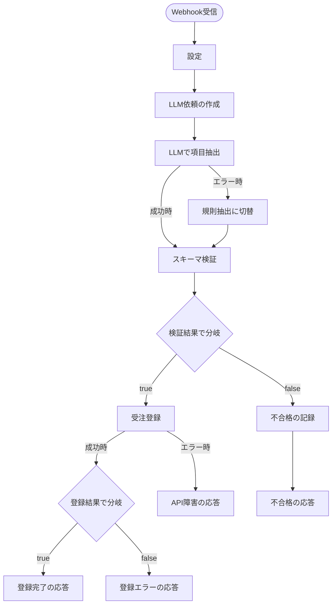

# FLW-001 受注メール取込 フロー設計書

## 文書情報

| 項目 | 内容 |
|---|---|
| 文書ID | DD-FLW-001 |
| システム名 | 受注メール取り込み・月次帳票システム |
| 版 | 1.0 |
| 作成日 | 2026-11-15 |
| 状態 | 承認済 |

## 改版履歴

| 版 | 日付 | 変更内容 |
|---|---|---|
| 1.0 | 2026-11-15 | n8n のエクスポート（n8n/order-intake.json）から生成し、概要・エラー処理を記入 |

## 1. 概要

| 項目 | 内容 |
|---|---|
| フロー名 | 受注メール取込 |
| 基盤 | n8n |
| 目的 | 受注メールから受注項目を取り出して検証し、受注 API に登録する（FN-001） |
| 関連要件 | REQ-001, REQ-002, REQ-008, REQ-010 |
| トリガー | Webhook受信（webhook） |
| 同時実行 | 可。同じメールの同時実行は API の一意制約で 1 件だけ登録される |
| 想定件数 | 1 回 1 通。1 日 10〜30 通程度（月に数百件）を想定 |
| ステップ数 | 13 |

## 2. 全体図

## 3. トリガー

| No | 名前 | 種類 | 設定 | 条件・備考 |
|---|---|---|---|---|
| T1 | Webhook受信 | webhook | httpMethod=POST, path=order-intake, responseMode=responseNode |  |

## 4. ステップ一覧

| No | ステップ名 | 種類 | 前のステップ（実行条件） | 主な設定 | エラー時 | 備考 |
|---|---|---|---|---|---|---|
| 1 | 設定 | set | Webhook受信 | assignments={"assignments":[{"id":"fc481ad7-76eb-5991-9d67-bc92572e5510","name":"api_url","value":"http://host.docker.i… | 停止（既定） |  |
| 2 | LLM依頼の作成 | code | 設定 | jsCode=// Webhook で受けたメールから LLM への依頼を作る。 // Gmail トリガーに差し替えた場合は、下の src の取り方だけを変える（README 参照）。 const src = $('Webhook受信'… | 停止（既定） |  |
| 3 | LLMで項目抽出 | httpRequest | LLM依頼の作成 | method=POST, url=={{ $('設定').first().json.ollama_url }}/api/chat, sendBody=true, specifyBody=json, jsonBody=={{ JSON.st… | エラー出力へ分岐 |  |
| 4 | スキーマ検証 | code | LLMで項目抽出（成功時）、規則抽出に切替 | jsCode=// LLM の結果（または API の規則抽出の結果）を受注データにそろえ、JSON スキーマで検証する。 // スキーマは app/order_schema.json と同じもの（tools/build_n8n_work… | 停止（既定） |  |
| 5 | 規則抽出に切替 | httpRequest | LLMで項目抽出（エラー時） | method=POST, url=={{ $('設定').first().json.api_url }}/extract?mode=rule, sendBody=true, specifyBody=json, jsonBody=={{ J… | 停止（既定） |  |
| 6 | 検証結果で分岐 | if | スキーマ検証 | 出力: 0=true / 1=false、条件: options={"caseSensitive":true,"leftValue":"","typeValidation":"strict"}, conditions=[{"id":"0455d43… | 停止（既定） |  |
| 7 | 受注登録 | httpRequest | 検証結果で分岐（true） | method=POST, url=={{ $('設定').first().json.api_url }}/orders, sendBody=true, specifyBody=json, jsonBody=={{ JSON.stringi… | エラー出力へ分岐、失敗時に再試行（Max Tries=3、間隔 2000ms） |  |
| 8 | 不合格の記録 | httpRequest | 検証結果で分岐（false） | method=POST, url=={{ $('設定').first().json.api_url }}/rejections, sendBody=true, specifyBody=json, jsonBody=={{ JSON.str… | エラーでも続行（通常出力） |  |
| 9 | 登録結果で分岐 | if | 受注登録（成功時） | 出力: 0=true / 1=false、条件: options={"caseSensitive":true,"leftValue":"","typeValidation":"strict"}, conditions=[{"id":"930a72b… | 停止（既定） |  |
| 10 | API障害の応答 | respondToWebhook | 受注登録（エラー時） | respondWith=json, responseBody=={{ JSON.stringify({ stage: 'api', message: '受注 API に接続できませんでした' }) }}, options={"respon… | 停止（既定） |  |
| 11 | 不合格の応答 | respondToWebhook | 不合格の記録 | respondWith=json, responseBody=={{ JSON.stringify({ stage: 'validation', errors: $('スキーマ検証').first().json.errors }) }},… | 停止（既定） |  |
| 12 | 登録完了の応答 | respondToWebhook | 登録結果で分岐（true） | respondWith=json, responseBody=={{ JSON.stringify($json.body) }}, options={"responseCode":"={{ $json.statusCode }}"} | 停止（既定） |  |
| 13 | 登録エラーの応答 | respondToWebhook | 登録結果で分岐（false） | respondWith=json, responseBody=={{ JSON.stringify({ stage: 'api', status: $json.statusCode, detail: $json.body }) }}, o… | 停止（既定） |  |

## 5. 接続・資格情報

なし

## 6. エラー処理・再実行

| 項目 | 内容 |
|---|---|
| エラー時の分岐 | あり（ステップ一覧の「エラー時」「実行条件」参照） |
| 通知先 | Webhook の呼び出し元へ応答コードで返す（422／503）。Gmail Trigger に差し替える場合はメール・チャット通知を追加 |
| 再実行の方法 | 同じメールの JSON を Webhook に再送する。n8n の実行履歴からの再実行も可 |
| 二重実行時の影響 | なし。2 回目は 200（duplicate=true）で既存の受注を返す（ADR-0003） |

## 7. 未決事項

なし
